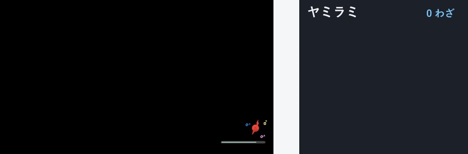

# ch-data-collector

ポケモンチャンピオンズの技一覧の画面を録画した動画から、各ポケモンが覚える技を読み取り、JSONで出力するツール。画面の文字をOCRで読み、ポケモン名と技名を`data/master/`の一覧の表記に統一する。



読み取ったデータは[pokemon-champions-data](https://github.com/ycookiey/pokemon-champions-data)でCC0として公開している。収録済みのポケモンと未収録のポケモンは[収録状況のページ](https://ycookiey.github.io/pokemon-champions-data/)を参照。

## 必要なもの

- [uv](https://docs.astral.sh/uv/)。Python 3.12と依存するライブラリはuvがインストールする
- 約5GBの空き容量。依存するライブラリの容量の大半をPyTorchが占める
- 動作を確認したOSはWindows。macOSは依存するPyTorchの配布物が無いためインストールできない
- CUDAに対応したNVIDIAのGPUがあれば、OCRにGPUを使う。GPUが無い環境ではCPUで読むため、処理に時間がかかる
- 初回の実行時に、EasyOCRが文字認識のモデルをダウンロードする

## インストール

```bash
git clone https://github.com/ycookiey/ch-data-collector.git
cd ch-data-collector
uv sync
```

以降のコマンドはクローンしたフォルダで実行する。

## 録画する動画

- ゲームの表示言語が日本語の画面を、黒帯や切り抜きの無い16:9の全画面で録画した動画。テレビの画面をカメラで撮った動画は読めない
- 854×480と1920×1080の動画で読み取れることを確認した
- 1本の動画に複数のポケモンを続けて録画してよい。複数の動画を指定すると、解像度が同じ動画どうしを指定した順に連結して読む

ポケモンごとに、ボックスの画面でポケモンを選び、技一覧の画面を開いて一周スクロールする。詳細は[録画の手順](docs/recording-guide.md)を参照。

## 使い方

```bash
uv run ch-data-collector video.mp4 -o learnset.json --fps 60
```

- `--fps`には動画のフレームレートを指定する。小さい値を指定すると、スクロール中に通り過ぎた技を読み落とす。既定値は5
- ポケモン名の候補の一致度が低いときと、読んだ文字に十分に近い技名が無いときは、候補の一覧を表示して選択を待つ。`--no-prompt`を付けると選択を求めず、ポケモン名は最も近い候補を採り、十分に近い技名が無い文字は捨てる
- 出力は`{"ポケモン名": ["技名", ...]}`の形のJSON。ポケモンを特定できなかった区間は、`(unknown 3)`のような名前で出力される
- 動画のどこにどのポケモンが映っていたかを、出力ファイルの名前の末尾に`.segments.json`を付けたファイルに保存する
- そのほかのオプションは`uv run ch-data-collector --help`を参照

### データを提出する

pokemon-champions-dataの[技データの提出](https://github.com/ycookiey/pokemon-champions-data/issues/new?template=collect.yml)のissueに、出力したJSONを貼り付けて送る。送ったJSONを自動で検証し、問題が無ければデータを追加するPull Requestを作る。`(unknown 3)`のような名前は検証で弾かれるため、消してから貼り付ける。

## アンインストール

クローンしたフォルダを削除する。EasyOCRのモデルは`~/.EasyOCR/`に残るため、不要なら削除する。uvのキャッシュに残ったPyTorchなどのライブラリは`uv cache clean`で消せるが、ほかのプロジェクトが使うキャッシュも消える。

## ライセンス

コードと`data/master/`のデータは[MIT License](LICENSE)。技の一覧`data/master/moves.json`はMIT Licenseの[towakey/pokedex](https://github.com/towakey/pokedex)から作った。towakey/pokedexの著作権の表示と許諾の文は[data/master/LICENSE](data/master/LICENSE)にある。ポケモン名の一覧`data/master/pokemon.json`は、CC0の[pokemon-champions-data](https://github.com/ycookiey/pokemon-champions-data)の`data/pokemon.json`から作った。技名やゲームの画面などの著作権は株式会社ポケモン・任天堂・ゲームフリーク・クリーチャーズにあり、このリポジトリの作者は権利を主張しない。
