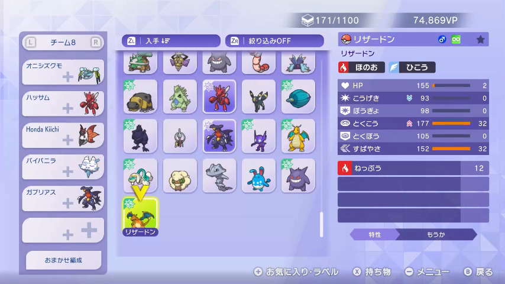
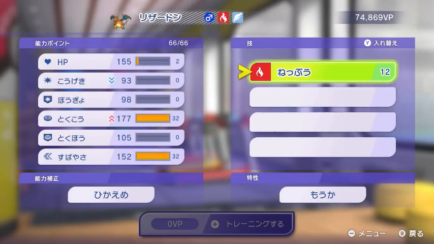
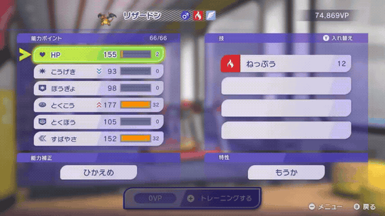

# 録画の手順

ch-data-collectorで技を読み取る動画の録り方。ゲームの画面だけを、黒帯や切り抜きの無い16:9の全画面で録画する。

## 手順

1. ボックスの画面で、技を読み取るポケモンを選ぶ。ch-data-collectorは右のパネルに表示される種族名でポケモンを特定するため、ニックネームを付けたポケモンも特定できる。

   

   ポケモンを選ぶと能力ポイントの画面が開く。能力ポイントの画面から技一覧の画面に進む。

   

2. 技一覧の画面で、最初に表示された技がもう一度表示されるまでスクロールする。技一覧は最後の技の次に最初の技が表示されるため、どの技からスクロールを始めてもよい。左右のキーを長押しするとページ単位で送れるため、上下のキーより速く一周できる。

   

3. ボックスの画面に戻って次のポケモンを選び、1と2を繰り返す。1本の動画に複数のポケモンを録画してよい。

## 読み取れない録画

- ボックスの画面を通らずに技一覧の画面を開いた録画。ポケモンを特定できない
- 最初の技がもう一度表示される前にスクロールを止めた録画。一部の技が映らない
- テレビの画面をカメラで撮った録画
- 画面の一部を拡大した録画、画面の一部を切り抜いた録画

## 提出

読み取った技データの提出先は[README](../README.md#データを提出する)を参照。

---
ゲーム本体・技名・画面などの著作権は株式会社ポケモン・任天堂・ゲームフリーク・クリーチャーズにある。
